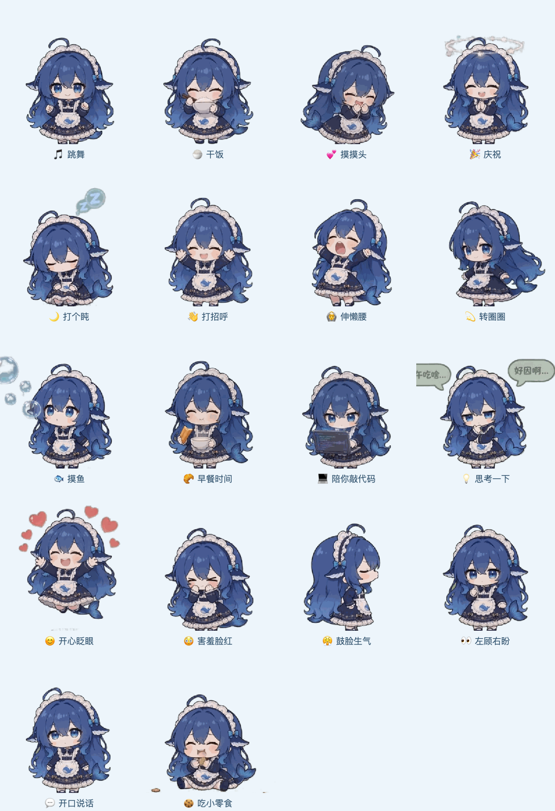

<p align="center">
  
</p>

<h1 align="center">大肥鱼 · Claude 用量伴侣</h1>

<p align="center">在 macOS 桌面陪你写代码，摸摸头、吃白饭、跳支舞，也帮你看看 token 和 DeepSeek 余额。</p>

<p align="center">
  
  
  
  
</p>

这是一个独立的 macOS / PySide6 桌宠适配项目。代码公开采用 **MIT** 许可；**角色、动画和衍生图标遵循上游的署名、非商业使用约定**，不能将素材当作 MIT 素材商用。

角色动画原作者：[PC2005-cloud/dsh-pet](https://github.com/PC2005-cloud/dsh-pet)。素材副本来自 [Refining-colors/pet-with-you](https://github.com/Refining-colors/pet-with-you)，桌宠基础代码来自 [1190fasheqi/dafeiyu-pet](https://github.com/1190fasheqi/dafeiyu-pet)。本项目与 DeepSeek、Anthropic 无官方隶属关系。

## 看看大肥鱼

| 吃白饭：张嘴、扒饭、鼓腮咀嚼 | 伸懒腰：完整人物动作 |
| :---: | :---: |
|  |  |

### 连续三击，看一眼余额

快速连续点击大肥鱼三次，她会歪头、托腮想一想：“唔…还剩多少呢？”小圆点带出轻轻弹入、浮动的云朵气泡，再显示余额。即使接口很快返回，也保留约 1.15 秒的思考过程；结果停留数秒后淡出，人物回到待机。

余额使用更大的圆润数字。查询中会区分上次记得的余额和刚核对的余额；没有缓存或网络失败时，使用角色口吻简短提示。晚到的回复不会重新弹出已经结束的气泡。

<p align="center"></p>

上图 `¥12.34` 为虚构演示余额，不包含真实账户信息。这里和上方 GIF 中的角色均来自 [PC2005-cloud/dsh-pet](https://github.com/PC2005-cloud/dsh-pet)。

### 所有说话气泡一起换装

普通说话使用带弧形小尾巴的漫画气泡，内心独白使用云朵和小圆点；统一采用奶白 / 浅蓝底、蓝紫描边、柔和阴影与轻微弹入 / 浮动。气泡会跟随当前人物姿势调整高度，短句贴近头顶，长句自动换行。

字体优先使用 macOS 自带的「圆体」，不额外分发字体。默认人物尺寸下，正文约 16 px，余额数字约 30 px；随人物大小适配。

<p align="center"></p>

角色动画原作者：[PC2005-cloud/dsh-pet](https://github.com/PC2005-cloud/dsh-pet)。

<details>
<summary>查看 18 种动作与表情</summary>




</details>

## 可以做什么

- 完整透明角色动画：干饭、跳舞、挥手、伸懒腰、打盹、害羞、生气、思考等 18 种动作。
- 单击、双击只做人物反馈；聊天、投喂和动作面板从右键进入。
- 三击联动托腮思考和运动云朵气泡，不打开聊天窗口，也不展开用量卡片。
- 原生 macOS 浮窗策略：点击其他应用时继续显示，支持跨 Spaces 和全屏辅助窗口。
- 本地统计 Claude Code JSONL 日志中的输入、输出、缓存和请求数；按会话 / 消息 ID 去重。
- DeepSeek 官方余额查询，以及监测开始后观察到的账户扣款。
- DeepSeek Flash 非思考聊天；按需加载角色帧，最多缓存 30 帧。

## 下载安装

到 [Releases](https://github.com/MichealRW/dafeiyu-claude-mac/releases/latest) 下载 macOS 安装包，解压后将 `大肥鱼桌宠.app` 放入 `~/Applications/`，打开即可。

首个预构建包为 **Apple Silicon / arm64**。Intel Mac 请在自己的机器上按下文从源码构建。发布包采用本地临时签名，未进行 Apple Developer ID 签名或公证；macOS 是否允许打开取决于系统安全策略。本项目不要求关闭 Gatekeeper。

桌宠需要能访问 DeepSeek 官方 API 的本机配置。它会读取已经配置好的 Claude-3p 活跃配置，或 `~/.claude/settings.json` 中的 `env`，并仅在 `ANTHROPIC_BASE_URL` 为 `https://api.deepseek.com/anthropic` 时复用 `ANTHROPIC_AUTH_TOKEN` / `ANTHROPIC_API_KEY`。不会把 Key 再存一份。聊天使用固定的 DeepSeek 官方接口。

没有配置 Key 时，动画和本地用量统计仍可使用，余额和聊天会提示配置不可用。此项目提供桌宠和用量伴侣，不自动修改 Claude 的模型路由。

## 鼠标操作

| 操作 | 效果 |
| --- | --- |
| 单击 / 双击 | 笑、害羞、挥手等人物反馈，等待系统连击判定后播放 |
| 连续三击 | 头顶显示余额气泡，并刷新余额 |
| 按住左键拖动 | 移动桌宠；拖动不计入三击 |
| 右键人物 / 用量卡片 | 聊天、投喂、动作与表情、显示用量、设置、退出 |
| 菜单栏小鱼图标 | 找回桌宠；右键可打开功能菜单 |

可以从动作面板关闭空闲小动作、调整舞蹈节奏。登录时启动默认关闭，可从右键菜单开启。

## 从源码运行

需要 macOS 和 Python 3.12。首次安装依赖需要网络。

```bash
git clone https://github.com/MichealRW/dafeiyu-claude-mac.git
cd dafeiyu-claude-mac
python3 -m venv .venv
source .venv/bin/activate
python -m pip install -r requirements.txt
python main.py
```

## 构建 macOS 应用

在已激活的虚拟环境中执行：

```bash
python -m pip install -r requirements-build.txt
bash scripts/build_macos.sh
```

生成 `dist/大肥鱼桌宠.app`。在目标架构的 Mac 上构建，会得到对应架构的应用。构建路径不依赖维护者本机目录。

重新生成图标可运行 `python scripts/generate_icon.py`。余额演示动图使用真实界面渲染和虚构数据，重新生成前安装 Pillow，再运行 `python scripts/render_balance_demo.py`。

## 验证

```bash
QT_QPA_PLATFORM=offscreen python -m unittest -v test_interactions test_monitor test_bubbles
```

测试使用临时目录和模拟网络，覆盖点击 / 三击 / 拖动、完整动画帧、流式消息去重、日志跨日、余额充值，以及快速 / 延迟回复、思考状态、用户打断交互。CI 在 macOS 上运行相同检查。

## 数据与隐私

- 读取 `~/.claude/projects/**/*.jsonl`，只提取用量等统计信息；不会上传 Claude 会话、代码或屏幕。
- 聊天只发送桌宠聊天输入和本次进程中的最近聊天上下文。
- API Key 通过标准输入交给系统 curl，不出现在 curl 命令参数中；HTTPS 使用系统证书验证。
- 设置和数字记录保存在 `~/Library/Application Support/Dafeiyu/`，不在仓库中。
- 用量约每 3 秒更新，账户余额每 30 秒更新；每日统计以北京时间分日。
- 账户扣款是桌宠开始监测后观察到的余额下降，包含同账户其他应用，**不等同于 Claude 单独消费**；余额可能有延迟和舍入。
- 本项目只统计日志已报告的用量，不能补回桌宠启动前未观察到的账户余额变化。

## 来源与许可

| 内容 | 来源 / 许可 |
| --- | --- |
| 本项目新增代码 | MichealRW，MIT，见 [LICENSE](LICENSE) |
| 桌宠基础代码与原始静态图 | [1190fasheqi/dafeiyu-pet](https://github.com/1190fasheqi/dafeiyu-pet)，保留原声明；角色形象仍受原作素材约定约束 |
| 完整角色动画 | [PC2005-cloud/dsh-pet](https://github.com/PC2005-cloud/dsh-pet)，允许开源使用、禁止商用，公开展示须附原作者链接 |
| 动画副本 | [Refining-colors/pet-with-you](https://github.com/Refining-colors/pet-with-you) |
| 形象 | 社区 DeepSeek「大肥鱼」；原型「溟月」出自上善无形，女仆鲸鱼娘设计出自 ZipZipPipe，上游标注 CC BY-NC-SA 4.0 |
| 图标及演示 | 使用上述角色素材制作，沿用角色的署名、非商用及适用的相同方式共享要求 |

详见 [素材署名](ANIMATION_ATTRIBUTION.md)、[素材许可范围](ASSET_LICENSE.md) 与 [第三方说明](NOTICE.txt)。**MIT 代码许可不覆盖角色、动画、预览 GIF 和衍生图标。**
